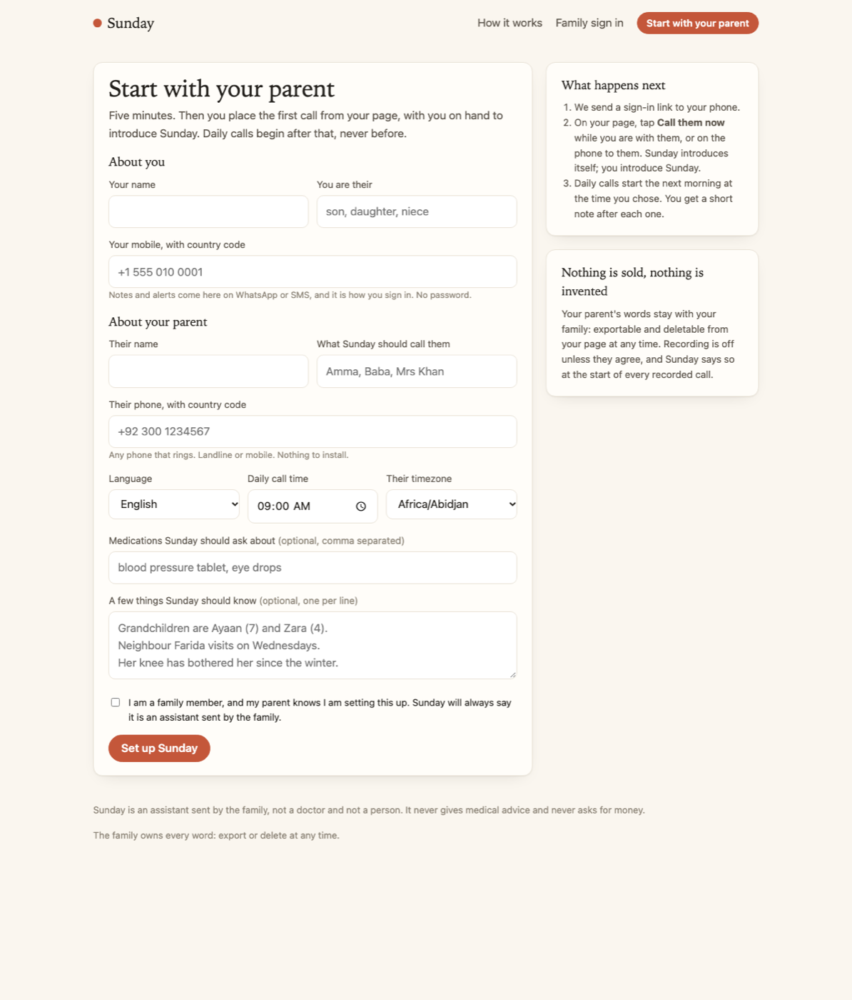

# Sunday

A warm daily phone call for an ageing parent, on the phone they already have.
Afterwards the family gets a two-line note on WhatsApp; if something is wrong,
they get an alert straight away. The parent never touches technology. Built in
Python on Twilio Conversation Relay for speech, OpenAI for the conversation,
and SQLite for everything that must not be lost.

- **Honest and warm.** Opens with a fixed line that says who it is and who sent it. Short turns, one question at a time, the parent's name only now and then. Remembers yesterday ("did the plumber come?") and passes on messages from the family.
- **Safe by code, not by prompt.** "I fell", "chest pain", "can't breathe" (English, Urdu, Hindi, Punjabi, Latin or native script) are caught by keyword triggers before any model runs. The whole family is alerted before Sunday says another word; the call switches to calm scripted lines with the right emergency number for the parent's country and stays on the line.
- **Nothing invented.** Every observation, alert and memory must quote the parent's words; quotes not found in the transcript are dropped. Household chores become follow-ups, never alerts. No medical advice, ever.
- **They can call it too.** Save the number as "Sunday". A call from the parent's own phone is answered by name, skips the morning survey, passes on anything waiting and just talks; the family gets the same short note.
- **Reminders on the right day.** "Your appointment is Tuesday at 10 with Dr Khan" is queued once and said on the day you choose, not tonight.
- **Set up in five minutes, from the website.** "Start with your parent" creates the household and sends you a sign-in link. You place the introductory call from your page, with you on hand to introduce Sunday; daily calls begin only after that, so a number typed into a form is never rung on its own.
- **A quiet page for the family.** Sign in with the phone Sunday already messages (no password: a one-time link). Today's note, the last two weeks at a glance, alerts to acknowledge, what to ask tomorrow, what Sunday knows, medications, who hears what, invite a sibling, and a one-click export of everything.
- **Recordings, only with consent.** The family records the parent's agreement; Sunday says "this call is recorded for the family, as you agreed" at the start of every recorded call; the family listens from the call page, and the note links to it.
- **Runs with no accounts.** An offline brain, a console messenger and a terminal simulator let you design the conversation before paying for anything.


- **Degrades politely.** If the model is down the call ends with a kind line and the transcript is kept. Two missed calls raise a note; three raise an alert.

## Setup

Requires Python 3.11+.

```bash
git clone https://github.com/Daniyal-Murtaza/agealth.git
cd agealth
python3 -m venv .venv && source .venv/bin/activate
pip install -r requirements.txt
pip install -e .
cp .env.example .env            # then add your keys
```

`.env`:

```
SUNDAY_PROVIDER=openai          # or `fake` to use the offline brain, no key needed
OPENAI_API_KEY=sk-...           # https://platform.openai.com/api-keys
OPENAI_MODEL=gpt-4.1-mini       # optional

TWILIO_ACCOUNT_SID=AC...        # only for real calls; the simulator works without these
TWILIO_AUTH_TOKEN=...
TWILIO_FROM_NUMBER=+1...        # your Twilio voice number
TWILIO_WHATSAPP_FROM=whatsapp:+14155238886   # sandbox or approved sender
SUNDAY_PUBLIC_URL=https://your-tunnel.example.com

SUNDAY_SECRET_KEY=              # signs family sign-in links and sessions; required for `sunday serve`
                                # python -c "import secrets; print(secrets.token_urlsafe(32))"
SUNDAY_DB=./data/sunday.sqlite  # optional
SUNDAY_MAX_CALL_MINUTES=12      # optional
```

A real call costs roughly $0.07/min for Conversation Relay plus voice minutes
and a few cents of model usage. Fully pinned transitive versions are in
`requirements.lock.txt`.

## Try it in your terminal

No phone and no Twilio: you type as the parent, Sunday talks, and the family
note prints at the end.

```bash
sunday parent add --name "Fatima Zaidi" --phone +923001234567 --language en \
  --time 09:00 --timezone Asia/Karachi --call-me Amma --introduced-by "your son Daniyal"
# prints an id like par_1a2b3c...

sunday family add par_XXXX --name Daniyal --phone +15550001 --relation son \
  --channel console --alerts info --primary
sunday family add par_XXXX --name Hira --phone +15550002 --relation daughter \
  --channel console --alerts now
sunday med add par_XXXX "blood pressure tablet" --when morning
sunday memory add par_XXXX "Grandchildren are Ayaan (7) and Zara (4)." --topic family
sunday message par_XXXX --from Hira "I'll call Thursday after work."
sunday message par_XXXX --from Daniyal --kind ask "Do you want a lift to the clinic on Tuesday?"
sunday message par_XXXX --from Daniyal --kind remind --on 2026-11-02 "Appointment at 10 with Dr Khan tomorrow."

sunday simulate par_XXXX        # have the call
sunday show par_XXXX            # calls, alerts, memories, queued messages
sunday digest par_XXXX          # the week in plain language
sunday status                   # everyone at a glance
```

Things to try in the simulator:

- Answer "I slept a bit late, took my tablet with my chai" and watch Sunday not ask about sleep or medication again.
- Say "the plumber still hasn't come" and see it land in tomorrow's follow-ups, not as an alert.
- Say "I fell and I can't get up". Every family member is alerted before Sunday's next line, and the call switches to the emergency script without consulting the model.
- Say "Haven't eaten yet, I'll make something later" and nothing is raised; say "I haven't eaten since yesterday" and the family gets a "check today" note.
- Say "I'm tired, let's talk tomorrow" and get a warm close, unless a family "ask" is still unanswered.

Family members with `--alerts now` only hear about emergencies; `today` adds
things worth checking on today; `info` gets every note and the weekly digest.

## The family page

```bash
sunday demo       # seeds Amma with two weeks of history so the page has something to show
sunday serve      # http://127.0.0.1:8000 - loopback only; put a tunnel in front for real use
```

Open http://127.0.0.1:8000. "Start with your parent" walks a new family through
set-up; or click Family sign in and enter `+1 555 010 0001` (Daniyal, from the
demo). With the console messenger the one-time link prints
in the `sunday serve` terminal; with Twilio configured it arrives on WhatsApp
or SMS, the same way the daily notes do. The page is scoped to the parents
whose family record carries that number, and nothing else.




## Real calls (Twilio)

1. Buy a voice number in the Twilio console and fill in the `TWILIO_*` values in `.env`. For WhatsApp notes also set `TWILIO_WHATSAPP_FROM` (the sandbox works) and give family members `--channel whatsapp`; `--channel sms` also works.
2. Expose the server: `ngrok http 8000` (or `cloudflared`) and set `SUNDAY_PUBLIC_URL` to the tunnel address.
3. `sunday serve` in one terminal. It binds to 127.0.0.1 and hosts the family page and the Twilio webhooks; the tunnel is the public face. Twilio's webhooks are verified against your auth token and rejected otherwise.
4. In another: `sunday call par_XXXX`. The parent's phone rings; the family note arrives when the call ends.
5. Recordings: tick "Recording" on the family page once the parent has agreed. Twilio records the call (dual channel) and posts to `/twilio/recording/{call_id}` when it is ready; the family listens through the app, never from a Twilio URL.
6. So the parent can call in: in the Twilio console set the number's voice webhook to `https://<your-tunnel>/twilio/inbound` (POST). Sunday matches the caller id to a parent; unknown numbers hear a kind refusal. Save the number in the parent's phone as "Sunday".
7. For daily calls run `sunday due` every five minutes from cron. It rings whoever's local call time it is, retries once fifteen minutes later if nobody answered and then leaves them alone for the day, records no-answers by day, and on Sunday evening (local time) sends each family their weekly report.

```
*/5 * * * * cd /path/to/agealth && .venv/bin/sunday due >> data/due.log 2>&1
```

## What the family receives

```
Sunday called Amma - Tue 14 May, 09:07 - sounded okay

Slept a little late but took her tablet with chai. Paratha for breakfast.
Still waiting on the plumber, third day.

Tomorrow I'll ask about: whether the plumber came

Replies to your messages:
- Yes to the lift on Tuesday, after eleven.
```

An emergency message looks different and goes first, before any analysis:

```
URGENT - Sunday about Amma
Amma said they fell. Please check on them immediately.
They said: "I fell in the kitchen and I can't get up"
Sunday is staying on the line with them. Please call them or go now.
```

## Verify offline

```bash
pytest                                   # 88 offline tests, ~3s
ruff check . && ruff format --check .    # lint / format
```

The tests use a scripted model and an in-memory database, so they need no
keys. They cover: self-serve onboarding (validation, the household it creates,
the sign-in link it sends, daily calls gated until the introductory call, no
duplicate household for a known number); recordings only with consent, the
notice in the opening line, the Twilio recording callback, and the audio
route refusing anyone outside the family; inviting a sibling and editing
medications; one retry after a missed morning and never more, with no-answers
counted by day; the family page (magic-link sign-in that is single-use, survives
a link preview, and is quiet about unknown numbers, a Secure HttpOnly session,
scoping so another family's parent is invisible even by id, every action, the
call page and the export); Twilio webhooks rejected without a valid signature and the relay
refusing an unregistered call; the server refusing to start without a secret;
a normal call through the plan to a warm close; a parent
calling in and getting a conversation instead of a survey, with the pipeline
running when the line closes; reminders held until their day; the weekly
report due once on Sunday evening; an old database gaining new columns; a fall that
alerts the family mid-call and switches to emergency mode without the model,
with the emergency number matching the parent's country; a `today` signal that
raises an alert while the call continues and changes the closing line; triggers
that stay quiet for "no pain today" and "I'll eat later"; turn and time budgets;
the model failing mid-call; the tired-parent shortcut and the open-ask gate; a
message only counting as delivered when Sunday actually said it; analysis that
drops unquoted claims, never downgrades a code signal, demotes household alerts
to follow-ups and records a forgotten plumber; the Twilio TwiML and WebSocket
round trip; no-answer escalation; the after-call pipeline respecting alert
tiers, not re-sending an alert, and surviving a failed messenger; a digest that
leads with the week's alerts; the scheduler; and the CLI end to end.

## Design

See [ARCHITECTURE.md](ARCHITECTURE.md) for the call session, the three rules
the code enforces, what the live runs changed, failure handling and tradeoffs.

## Project layout

```
sunday/
  cli.py            parent / family / med / memory / message / simulate / call / due / serve / demo
  demo.py           two weeks of believable history for the family page
  web/
    __init__.py     routes: landing, sign-in, the family page and its actions, export, Twilio
    auth.py         one-time links over WhatsApp/SMS, signed session cookie, rate limits
    twilio_auth.py  X-Twilio-Signature verification, fail-closed
    templates/      base, landing, login, family, call
    static/         one stylesheet, no framework, no web fonts
  scheduler.py      who is due a call now; whose weekly report is due
  config.py         settings (.env)
  models.py         Parent, FamilyMember, Call, Turn, Observation, Alert, QueuedMessage, Memory
  repository.py     every SQLite query, in one place
  brain/
    safety.py       multilingual keyword triggers, tiers, emergency script
    conversation.py call plan, system prompt, next line, progress bookkeeping
    analysis.py     transcript -> summary, observations, memories, alerts (all quoted)
    model.py        ChatModel protocol, OpenAI adapter, scripted model for tests
    offline.py      rule-based brain so the product runs with no API key
  calls/
    session.py      the live-call state machine
    transport.py    Twilio Conversation Relay (TwiML + WebSocket), inbound calls, the terminal simulator
    dialer.py       outbound calls and no-answer escalation
  notify/
    pipeline.py     after-call: alerts first, then analysis, storage, family notes
    messenger.py    WhatsApp / SMS via Twilio, or the console
    digest.py       weekly trends in plain language
tests/              offline unit and end-to-end tests
```
