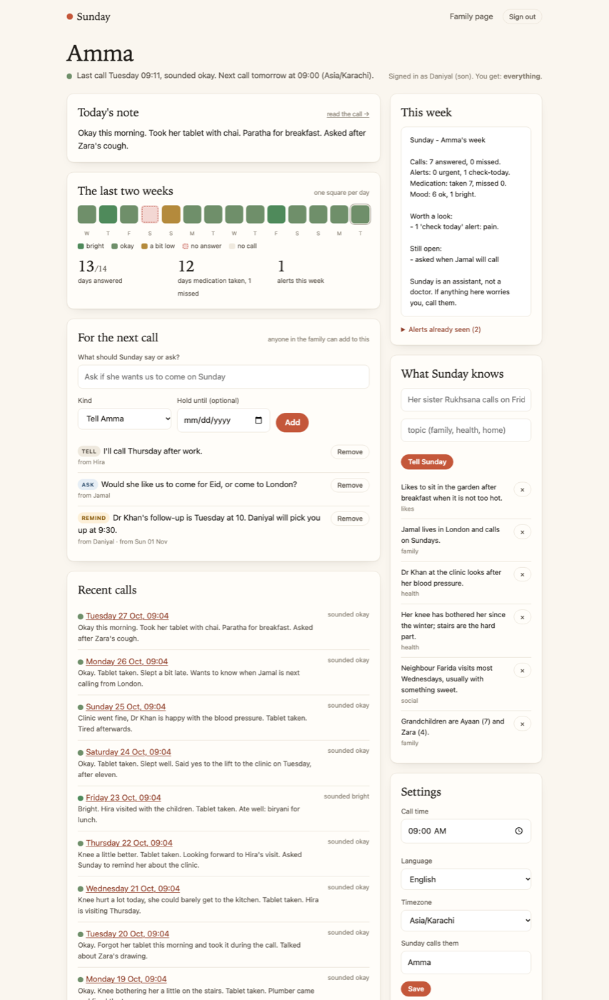
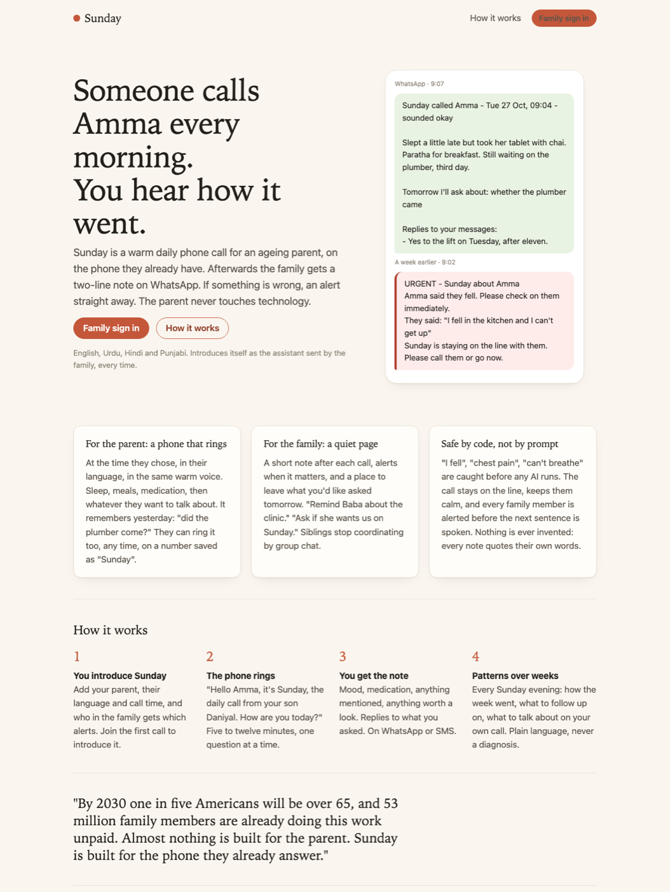

# Sunday

A warm daily phone call for an ageing parent, on the phone they already have.
Afterwards the family gets a two-line note on WhatsApp; if something is wrong,
they get an alert straight away. The parent never touches technology.

Built in Python on Twilio Conversation Relay for speech, OpenAI for the
conversation, and SQLite for everything that must not be lost. Everything can
be tried on a laptop with no accounts at all; the phone line and the AI model
are added at the end.



- **Honest and warm.** Opens with a fixed line that says who it is and who sent it. Short turns, one question at a time, the parent's name only now and then. Remembers yesterday ("did the plumber come?") and passes on messages from the family.
- **Safe by code, not by prompt.** "I fell", "chest pain", "can't breathe" (English, Urdu, Hindi, Punjabi, Latin or native script) are caught by keyword triggers before any model runs. The whole family is alerted before Sunday says another word; the call switches to calm scripted lines with the right emergency number for the parent's country and stays on the line.
- **Nothing invented.** Every observation, alert and memory must quote the parent's words; quotes not found in the transcript are dropped. Household chores become follow-ups, never alerts. No medical advice, ever.
- **They can call it too.** Save the number as "Sunday". A call from the parent's own phone is answered by name, skips the morning survey, passes on anything waiting and just talks.
- **Set up in five minutes, from the website.** "Start with your parent" creates the household and sends you a sign-in link. You place the introductory call from your page; daily calls begin only after that.
- **A quiet page for the family.** No password: a one-time link to the phone Sunday already messages. Today's note, the last two weeks at a glance, alerts to acknowledge, what to ask tomorrow, what Sunday knows, medications, who hears what, invite a sibling, export everything.
- **Recordings, only with consent.** Sunday says "this call is recorded for the family, as you agreed" at the start of every recorded call; the family listens from the call page.

This README is a walkthrough. It assumes you have never seen the product and
takes you through every feature, one at a time, telling you what to type and
what you should see. Allow about an hour for Parts 1 to 7 (no accounts needed)
and another hour for Part 8 (real phone calls).

---

## Contents

1. [What you need](#part-0-what-you-need)
2. [Part 1: Install](#part-1-install)
3. [Part 2: Your first call, in the terminal](#part-2-your-first-call-in-the-terminal)
4. [Part 3: Test every conversation and safety behaviour](#part-3-test-every-conversation-and-safety-behaviour)
5. [Part 4: Switch on the real AI](#part-4-switch-on-the-real-ai)
6. [Part 5: The family website](#part-5-the-family-website)
7. [Part 6: Self-serve onboarding, end to end](#part-6-self-serve-onboarding-end-to-end)
8. [Part 7: Reminders, the weekly report and the scheduler](#part-7-reminders-the-weekly-report-and-the-scheduler)
9. [Part 8: Real phone calls with Twilio](#part-8-real-phone-calls-with-twilio)
10. [Part 8b: Put the demo on the internet for free](#part-8b-put-the-demo-on-the-internet-for-free)
11. [Part 9: The automated tests](#part-9-the-automated-tests)
12. [Troubleshooting](#troubleshooting)
13. [Starting over](#starting-over)
14. [Design and project layout](#design-and-project-layout)

---

## Part 0: What you need

**For Parts 1 to 7 (everything except real phone calls):**

- A Mac or Linux computer. (Windows works with WSL.)
- Python 3.11 or newer. Check with `python3 --version`. If you see `Python 3.11.x` or higher you are fine. If not, install it from https://www.python.org/downloads/.
- A terminal. On a Mac: press Cmd+Space, type `Terminal`, press Enter. Every command below is typed into that window and finished with Enter.

**Optional, for Part 4:** an OpenAI API key (https://platform.openai.com/api-keys). A test call costs a few cents. Without it Sunday uses a built-in "offline brain" that follows a fixed script, which is enough to test every safety behaviour and the whole website.

**Optional, for Part 8:** a Twilio account with a voice number, and ngrok (free) to let Twilio reach your laptop.

One habit for the whole walkthrough: whenever you open a new terminal window, run these two lines first, otherwise the `sunday` command will not be found.

```bash
cd ~/agealth            # or wherever you cloned it
source .venv/bin/activate
```

---

## Part 1: Install

Step 1. Get the code and go into the folder.

```bash
git clone https://github.com/Daniyal-Murtaza/agealth.git
cd agealth
```

Step 2. Create a private Python environment and switch it on. You will see `(.venv)` appear at the start of your prompt.

```bash
python3 -m venv .venv
source .venv/bin/activate
```

Step 3. Install the dependencies and Sunday itself. This takes a minute.

```bash
pip install -r requirements.txt
pip install -e .
```

Step 4. Create your settings file from the example.

```bash
cp .env.example .env
```

Step 5. Open `.env` in any text editor and set these two lines. Leave everything else as it is for now.

```
SUNDAY_PROVIDER=fake
SUNDAY_SECRET_KEY=paste-the-output-of-the-command-below
```

To make a secret key, run this and paste the long string it prints:

```bash
python -c "import secrets; print(secrets.token_urlsafe(32))"
```

Step 6. Check it works.

```bash
sunday --help
```

You should see a list of commands: `message`, `simulate`, `call`, `due`, `status`, `digest`, `show`, `serve`, `demo`, `parent`, `family`, `med`, `memory`. If you see `command not found: sunday`, run `source .venv/bin/activate` and try again.

---

## Part 2: Your first call, in the terminal

Sunday keeps everything in a small database file, `data/sunday.sqlite`, which is created the first time you add a parent. In this part you create a parent and a family, then have the phone call yourself, typing what the parent would say.

Step 1. Add the parent. Change the names and numbers if you like; keep the `+` and country code on the phone number.

```bash
sunday parent add --name "Fatima Zaidi" --phone +923001234567 --language en \
  --time 09:00 --timezone Asia/Karachi --call-me Amma --introduced-by "your son Daniyal"
```

You should see: `Added Fatima Zaidi -> id par_xxxxxxxxxxxx`. Copy that id. Every command below uses it; where you see `par_XXXX`, type your id instead.

Step 2. Add two family members. Daniyal gets everything; Hira only wants emergencies. `--channel console` means their messages print in the terminal, which is how you will read them without WhatsApp.

```bash
sunday family add par_XXXX --name Daniyal --phone +15550001 --relation son --channel console --alerts info --primary
sunday family add par_XXXX --name Hira --phone +15550002 --relation daughter --channel console --alerts now
```

You should see `Added Daniyal (son), gets: info and above via console.` and the same for Hira with `now`.

Step 3. Tell Sunday about a medication and a couple of facts.

```bash
sunday med add par_XXXX "blood pressure tablet" --when morning
sunday memory add par_XXXX "Grandchildren are Ayaan (7) and Zara (4)." --topic family
sunday memory add par_XXXX "Neighbour Farida visits on Wednesdays." --topic social
```

Step 4. Leave two messages from the family for the next call: one to pass on, one that needs an answer.

```bash
sunday message par_XXXX --from Hira "I'll call Thursday after work."
sunday message par_XXXX --from Daniyal --kind ask "Do you want a lift to the clinic on Tuesday?"
```

Step 5. Check what Sunday knows before the call.

```bash
sunday show par_XXXX
```

You should see the parent's details, the medication, both family members, "Sunday knows" with your two facts, and "Queued for next call" with both messages.

Step 6. Have the call.

```bash
sunday simulate par_XXXX
```

Sunday speaks first: `Hello Amma, it's Sunday calling, the daily call from your son Daniyal. How are you today?` You are Amma. Type an answer and press Enter. Try this conversation, one line at a time:

```
I'm alright beta, slept a bit late but took my tablet with my chai
Yes, I'd like the lift, after eleven though
Just paratha and chai
The plumber still hasn't come, third day now
I'm a little tired now, let's talk tomorrow
```

With the offline brain Sunday follows a fixed script (it will ask about sleep, tablets, food in turn); with OpenAI (Part 4) it converses. Either way, when you say you are tired the call closes warmly: `It was lovely talking to you, Amma...`

Step 7. Read what the family received. Right after the call ends you will see:

```
--- to Daniyal (console +15550001) ---
Sunday called Amma - ...
```

followed by the note: how she sounded, medication, anything mentioned, "Tomorrow I'll ask about", and "Replies to your messages". Notice there is no `--- to Hira` block. Hira asked for emergencies only, and nothing was an emergency.

Step 8. Look at the stored result.

```bash
sunday show par_XXXX
```

The call now appears with its summary, and the two queued messages are gone (delivered). If you type `/hangup` during a call instead of ending it, the transcript is still saved.

---

## Part 3: Test every conversation and safety behaviour

Each test is one simulated call. Start each with `sunday simulate par_XXXX`, type the lines shown, and check the result. Tests marked **(AI)** need the real model from Part 4; the rest work with the offline brain because they are enforced by code, not by the model.

### 3.1 A fall: the family is alerted before Sunday's next sentence

Type:
```
Not good beta, I fell in the kitchen and I can't get up
```
Expect, in this order: a warning line in the terminal, then `--- to Daniyal` and `--- to Hira` both with `URGENT - Sunday about Amma`, quoting your exact words, then Sunday's line `I'm here with you. Stay where you are, don't try to get up alone.` Both family members get this one, including Hira. Keep typing (`my hip hurts`, `yes the phone is in my hand`): Sunday stays on the line with calm scripted lines and gives the emergency number for Pakistan, `1122`, because the parent's number starts with +92. Type `/hangup` to end. The note afterwards says she sounded low and does not say "you're well".

### 3.2 The same phrases in Urdu, Hindi or Punjabi

Type `main gir gayi` (Urdu, Latin script) or `मैं गिर गई` or `گر گئی`. Same emergency path. Try `seene mein dard` (chest pain) or `saans nahi aa rahi` (can't breathe).

### 3.3 Significant pain is a "check today", not an emergency

Type:
```
Alright beta, but my knee hurts so much today I could barely walk to the kitchen
```
Expect: the call carries on normally (no emergency script). After the call, Daniyal gets a separate message `Please check today - Sunday about Amma / Amma mentioned significant pain today.` Hira does not (she only wants `now`). The closing line says "I'll let the family know how you're doing today" instead of "you're well".

### 3.4 Breakfast on its way is not an alert

Type:
```
Haven't eaten yet, I'll make something later
```
Expect: no alert. Now in another call type `I haven't eaten since yesterday`: Daniyal gets `Amma said they have not eaten.`

### 3.5 "No pain today" stays quiet

Type `No pain today, I didn't have any fever either`. Expect: no alert. The denial is understood.

### 3.6 The plumber is a follow-up, never an alert

Type `The plumber still hasn't come, third day now, the tap is dripping`. Expect: no alert; the note ends with `Tomorrow I'll ask about: plumber still hasn't come` (wording may vary). On the next call that item is in Sunday's context.

### 3.7 A family "ask" keeps the call open until it is answered

Queue an ask first: `sunday message par_XXXX --from Daniyal --kind ask "Do you want us to come on Sunday?"`. In the call, say `I'm tired, let's talk tomorrow` before answering it. Expect: Sunday does not close; it asks the question. Answer it (`Yes, come after lunch`), then say you are tired: now it closes. The reply appears under "Replies to your messages".

### 3.8 A "tell them" message only counts when actually said **(AI)**

Queue `sunday message par_XXXX --from Hira "I'll call Thursday after work."` and have a call. Expect Sunday to actually say something like "Hira asked me to tell you she'll call Thursday after work". If it only said "I'll let Hira know", the message would stay queued for the next call; `sunday show` tells you which happened.

### 3.9 No double-asking **(AI)**

Open with `I'm alright, slept a bit late but took my tablet with my chai`. Expect Sunday not to ask about sleep or the tablet again.

### 3.10 Name used sparingly **(AI)**

Over a six-turn call, "Amma" should appear in roughly one line in three, never in every sentence.

### 3.11 Nothing invented **(AI)**

After any call, run `sunday show par_XXXX`. Every observation and memory shown came with a quote from the transcript; anything the model wrote that you did not say was dropped before storage.

### 3.12 The model goes down mid-call

Set `SUNDAY_PROVIDER=openai` with a wrong key (`OPENAI_API_KEY=sk-wrong`) and simulate. Expect the opening line (fixed, no model), then on your first reply a kind fallback: `I'm sorry, I'm having a little trouble hearing today...` and the call ends politely. The transcript is still saved. Put the setting back afterwards.

### 3.13 Alert levels per family member

Run `sunday show par_XXXX` after 3.1 and 3.3. The alerts list shows `NOW: Amma said they fell` and `TODAY: ...`. In the console blocks you saw who received what: Hira only the URGENT one.

---

## Part 4: Switch on the real AI

Step 1. Put your key in `.env`:

```
SUNDAY_PROVIDER=openai
OPENAI_API_KEY=sk-...
OPENAI_MODEL=gpt-4.1-mini
```

Step 2. Repeat Part 2 Step 6. Now Sunday converses: it picks up on Farida, asks about Ayaan, passes on Hira's message early, asks Daniyal's question and waits for the answer, and does not re-ask what you already said. Then run the **(AI)** tests in Part 3.

A call costs a few cents. If you see `OPENAI_API_KEY is not set`, the `.env` line is missing or you are in a different folder.

---

## Part 5: The family website

The website has a public landing page, a sign-in by one-time link, and the family page. It runs on your laptop only (`127.0.0.1`); nobody else can reach it until Part 8.

Step 1. Seed a demo family so the page has two weeks of history to show. This creates a separate demo parent ("Amma", +92 300 0000 001) with three family members; it does not touch the parent you made in Part 2.

```bash
sunday demo
```

You should see `Demo parent ready: par_...` and three phone numbers. The first, `+1 555 010 0001`, is Daniyal.

Step 2. Start the server. Leave this terminal window open; it prints the sign-in links and the family notes.

```bash
sunday serve
```

You should see `Sunday listening on http://127.0.0.1:8000`. If instead you see `SUNDAY_SECRET_KEY is not set`, go back to Part 1 Step 5.

Step 3. Open http://127.0.0.1:8000 in your browser. This is the public landing page: the pitch, a WhatsApp mock-up of a note and an alert, how it works. Click around; nothing here needs a login.

Step 4. Sign in. Click **Family sign in**, type `+1 555 010 0001`, click **Send me a link**. The page says "Check your phone". Now look at the terminal running `sunday serve`: a block `--- to Daniyal (console ...) ---` contains a link like `http://127.0.0.1:8000/auth/eyJ...`. Copy it into the browser.

You land on "One tap to continue", which submits itself. (That page exists because WhatsApp fetches links to make previews; the preview must not spend your one-time link.) You are now on Amma's page, signed in as Daniyal.

Step 5. Test that the link is single-use. Paste the same `/auth/...` link again. Expect the sign-in page with "That link has expired or was already used."

Step 6. Walk the page, top to bottom.

- **Header.** "Amma", last call and mood, next call time, and "Signed in as Daniyal (son). You get: everything." Next to it, **Call Amma now** (on this copy it leads to a page explaining there is no phone line yet; in Part 8 it rings).
- **Today's note.** The latest call's summary. Click **read the call →** to see the full transcript, "What Sunday noticed" with quotes, and any alerts. Click back.
- **The last two weeks.** Fourteen squares: green shades for answered calls by mood, a dashed red one for the morning nobody answered, grey for no call. Hover for the date; click a square to open that call. Below: days answered, days medication taken, alerts this week.
- **For the next call.** Type `Ask if she wants us to come for Eid`, choose **Ask, and get an answer**, click **Add**. It appears in the list with an `ASK` tag and "from Daniyal". Click **Remove** to take it off. Now add a reminder: type `Dr Khan's appointment is at 10 tomorrow`, choose **Remind**, pick a date next week in **Hold until**, click **Add**. It shows "from Sun 02 Nov" (your date): Sunday will not say it before then.
- **Recent calls.** Every call with mood dot and first line. Click any to read it.
- **This week.** The weekly report: calls, alerts, medication, mood, worth a look, still open. Under it, **Alerts already seen (2)**: the demo's knee-pain alert and the missed morning, each marked with who acknowledged it.
- **What Sunday knows.** Type `Her sister Rukhsana calls on Fridays`, topic `family`, click **Tell Sunday**. It appears at the top. Click the **×** next to it to make Sunday forget it.
- **Settings.** Change **Call time** to 08:30 and click **Save**; the header's "Next call" updates. Change it back if you like.
- **Medications Sunday asks about.** Add `eye drops` at `night`; remove it with **×**.
- **Recording.** A checkbox: "Amma has agreed that calls may be recorded..." Tick it. From now on every call opens with "This call is recorded for the family, as you agreed." (Run `sunday simulate <demo par id>` to hear the line; untick to turn it off. Actual audio needs Twilio, Part 8.)
- **Who hears what.** Daniyal, Hira, Jamal with their levels. Only your own row has a form: change yourself to **check-today + urgent** and **Save**; the header now says "You get: check-today and urgent". Change it back.
- **Invite a sibling.** Open it, type a name, relation, a phone with country code, pick a level, **Invite**. They appear in the list, and the `sunday serve` terminal shows the sign-in link that would have gone to their phone.
- **Export everything.** Downloads `sunday-amma.json`: parent, family, memories, alerts, and every call with its full transcript and observations.

Step 7. Test that another family cannot see Amma. In a fresh private browser window, sign in as a number that is not on Amma's family (your Part 2 parent's family, `+15550001`, works: ask for a link, copy it from the terminal). On that page, change the URL to `/app?parent=<the demo par id>`. Expect "no such parent on your account". Try `/app/<demo par id>/export.json`: 404.

Step 8. Test that an unknown number gets nothing. On the sign-in page enter `+1 555 999 9999`. The page still says "Check your phone", but the terminal shows no link was sent. The form never reveals which numbers are known.

Step 9. **Sign out** (top right). `/app` now redirects to the sign-in page.

Step 10. Alerts to acknowledge. Have an emergency call for the demo parent in a second terminal (`sunday simulate <demo par id>`, type `I fell`, then `/hangup`). Reload the family page: a red **Urgent** card at the top with the quote and an **I've seen this** button. Click it; the card moves under "Alerts already seen", marked "seen by Daniyal".

Stop the server with Ctrl+C when you are done, or leave it running for Part 6.

---

## Part 6: Self-serve onboarding, end to end

This is how a new family would arrive from the website without anyone touching the CLI.

Step 1. With `sunday serve` running, open http://127.0.0.1:8000 and click **Start with your parent**.

Step 2. Fill the form with made-up people. Use numbers that are not already in use, with country codes, for example yourself `+1 555 020 0001` and parent `+92 300 7654321`. Add a medication and a line or two of "things Sunday should know". Tick the confirmation box. Click **Set up Sunday**.

Step 3. The page says "Check your phone, <your name>". In the server terminal, copy the `/auth/...` link and open it. You are on the new parent's page.

Step 4. Notice the card at the top: **First, the introductory call**, with **Call <name> now**. Until that call happens the scheduler will never ring this parent, however you set the call time. Prove it:

```bash
sunday due --dry-run
```

shows "Nobody is due right now" even at the call time (Part 7 explains `due`).

Step 5. Stand in for the introductory call with the simulator. Find the new parent's id with `sunday status`, then `sunday simulate par_NEW`, say a few things, say goodbye. Reload the family page: the introductory card is gone and "Today's note" shows the call. Daily calls are now unlocked.

Step 6. Submit the form again with the same "your mobile". Expect "You're already set up" and a fresh sign-in link rather than a second household.

Step 7. Validation. Submit with a phone number missing the `+` country code, or with the confirmation unticked: the form comes back with a plain explanation of what to fix and nothing is created.

---

## Part 7: Reminders, the weekly report and the scheduler

**Dated reminders.** A message with `--on` (or "Hold until" on the website) is held until that local date:

```bash
sunday message par_XXXX --from Daniyal --kind remind --on 2030-01-02 "Appointment at 10 with Dr Khan."
sunday show par_XXXX            # listed with "(from Wed 02 Jan)"
sunday simulate par_XXXX        # not mentioned: it is not that day yet
```

**The weekly report.**

```bash
sunday digest par_XXXX          # prints the week: calls, alerts, medication, mood, worth a look, still open
sunday digest par_XXXX --send   # also sends it to family members who get "info"; console blocks print
```

**The scheduler.** `sunday due` is meant to run every five minutes from cron. Each run it does three things: rings every parent whose local call time it is (once, with one retry fifteen minutes later if nobody answered, then nothing more that day), records no-answers (two days in a row is a "check today" note; three is urgent), and on Sunday evening local time sends each family the weekly report, once.

```bash
sunday due --dry-run            # says who would be rung or sent a report right now, rings nobody
```

To watch it fire, set a parent's call time to a minute or two from now in their timezone (`--time HH:MM` in the website's Settings card) and run `sunday due --dry-run` again: `would call Fatima Zaidi (+92...) now`. Without Twilio configured, `sunday due` without `--dry-run` prints the same line instead of dialling.

---

## Part 8: Real phone calls with Twilio

Everything so far ran on your laptop. This part connects a real phone line. Budget: a Twilio trial account is free with credit; a call costs roughly $0.07 a minute for Conversation Relay plus voice minutes, and a few cents of model usage.

Step 1. Create a Twilio account at https://www.twilio.com, verify your own mobile (trial accounts can only call verified numbers), and buy a voice-capable number. Note the Account SID, Auth Token and the number.

Step 2. Install ngrok (https://ngrok.com/download) and sign in once (`ngrok config add-authtoken ...`). In a terminal that you leave open:

```bash
ngrok http 8000
```

Copy the `https://....ngrok-free.app` address it shows. This is how Twilio reaches your laptop. Sunday itself still only listens on 127.0.0.1; ngrok is the public face.

Step 3. Fill `.env`:

```
SUNDAY_PROVIDER=openai
OPENAI_API_KEY=sk-...
TWILIO_ACCOUNT_SID=AC...
TWILIO_AUTH_TOKEN=...
TWILIO_FROM_NUMBER=+1...
SUNDAY_PUBLIC_URL=https://....ngrok-free.app
SUNDAY_SECRET_KEY=...already set...
```

For WhatsApp notes, also join the Twilio WhatsApp sandbox (Messaging > Try it out > Send a WhatsApp message; send the join code from your phone) and set `TWILIO_WHATSAPP_FROM=whatsapp:+14155238886`. Family members with `--channel whatsapp` then get their notes on WhatsApp; `--channel sms` also works. Create a parent whose phone is your verified mobile, and a family member whose phone is also a real number you can read.

Step 4. Start the server in a second terminal:

```bash
sunday serve
```

Step 5. Place a call from a third terminal:

```bash
sunday call par_XXXX
```

Your phone rings. Answer; you hear "Hello Amma, it's Sunday calling..." Talk to it. Hang up or say you are tired. Within a few seconds the family note arrives on WhatsApp or SMS (or prints in the `serve` terminal for console members), ending with "Read the call: https://.../app/.../calls/..." Open that link, sign in with the family number, and read the transcript. The same call is available from the website's **Call Amma now** button.

Step 6. The parent calls Sunday. In the Twilio console, open your number, and under Voice set "A call comes in" to Webhook, `https://....ngrok-free.app/twilio/inbound`, HTTP POST. Save. Now ring your Twilio number from the parent's phone: "Hello Amma, it's Sunday. How lovely that you called. How are you?" No survey, just a conversation; the note says "Amma called Sunday". Ring from a number that is not a parent: a kind message that the number is not set up, and the call ends.

Step 7. Recordings. On the family page tick **Recording**. Place a call: it opens with "This call is recorded for the family, as you agreed." After it ends, open the call page: a **Listen** card with a player (if it says "still being prepared", wait a minute and reload). The audio is served through Sunday after checking you are family; Twilio's own URL is never shown.

Step 8. Emergency, for real. During a call say "I've fallen and I can't get up". The family phones get the URGENT message within a second or two, before Sunday's next sentence; Sunday stays on the line.

Step 9. Daily calls. Add a cron line (`crontab -e`):

```
*/5 * * * * cd /path/to/agealth && .venv/bin/sunday due >> data/due.log 2>&1
```

Each morning at the parent's call time their phone rings; if unanswered, once more fifteen minutes later; the note follows each answered call; Sunday evening brings the weekly report. `tail -f data/due.log` shows what it did.

Security notes for a real deployment: Twilio's webhooks are verified against your auth token and rejected otherwise; the server refuses to start without `SUNDAY_SECRET_KEY`; it binds to 127.0.0.1 and warns if asked to bind wider. Put a proper domain and TLS in front for anything beyond a demo.

---

## Part 8b: Put the demo on the internet for free

For sharing a link (an application, a friend, an investor), the website can run on Render's free tier with no card. Free instances sleep after fifteen idle minutes and take about a minute to wake, and have no disk, so the demo family is re-seeded on each start. That is exactly right for a demo link and wrong for a real family, who need the always-on paid instance plus Twilio.

Step 1. Open https://render.com/deploy?repo=https://github.com/Daniyal-Murtaza/agealth and sign in with GitHub (no payment details are asked for).

Step 2. Render reads `render.yaml` from the repo and shows one service, `sunday`, on the Free plan with its settings prefilled: a generated `SUNDAY_SECRET_KEY`, `SUNDAY_PROVIDER=fake`, the demo seeded and the demo sign-in switched on. Click **Apply** (or **Deploy Blueprint**).

Step 3. Wait for the build (two or three minutes the first time). The dashboard shows a URL like `https://sunday-xxxx.onrender.com`. Open it.

Step 4. Test the hosted copy: the landing page; **See a family's page** signs you in as Daniyal to the demo household; every card works as in Part 5. **Start with your parent** also works, though sign-in links for new families print only in Render's logs until Twilio is configured.

Step 5. To make the hosted conversations real, add `OPENAI_API_KEY` in the service's Environment tab and change `SUNDAY_PROVIDER` to `openai`. For real phones, add the Twilio variables and set `SUNDAY_PUBLIC_URL` to the Render URL, then point the Twilio number's webhook at it as in Part 8 Step 6.

Every push to `main` redeploys automatically.

---

## Part 9: The automated tests

Everything above is also covered by tests that need no keys and no network:

```bash
pytest                                   # 90 offline tests, ~3s
ruff check . && ruff format --check .    # lint / format
```

They use a scripted model and an in-memory database and cover: onboarding and the introductory-call gate; recordings only with consent and the audio route refusing non-family; the family page (single-use, preview-safe sign-in, Secure HttpOnly session, scoping, every action, export); Twilio signature verification failing closed; the scheduler's one retry and day-based no-answer counting; a fall alerting mid-call with the right emergency number; today-tier triggers, denials and "I'll eat later"; the tired-parent shortcut and the open-ask gate; messages only delivered when actually said; analysis dropping unquoted claims and demoting household alerts; inbound calls; dated reminders; the weekly report; database migration; and the CLI end to end.

---

## Troubleshooting

| You see | What it means | Do this |
|---|---|---|
| `command not found: sunday` | The virtual environment is not active in this window | `cd agealth && source .venv/bin/activate` |
| `SUNDAY_SECRET_KEY is not set` | `.env` has no secret | Part 1 Step 5 |
| `OPENAI_API_KEY is not set` | Provider is `openai` but no key | Set the key, or `SUNDAY_PROVIDER=fake` |
| `no parent 'par_...'` | Wrong id | `sunday status` lists ids |
| `Twilio is not configured` | `sunday call` without Twilio keys | Use `sunday simulate`, or Part 8 |
| `SUNDAY_PUBLIC_URL is not set` | Twilio cannot reach you | Part 8 Step 2 and 3 |
| "That link has expired or was already used" | Sign-in links work once, for 15 minutes | Ask for a new one |
| Sign-in link never appears | Member's channel is `whatsapp` but Twilio isn't configured | Set the member to `console`, or configure Twilio |
| `address already in use` on `serve` | Another server on port 8000 | `sunday serve --port 8001` and use that in the browser |
| The call ends with "trouble hearing today" | The model errored or timed out | Check the key and your connection; the transcript was saved |
| Twilio webhook returns 403 | Signature check failed | `SUNDAY_PUBLIC_URL` must be exactly the address Twilio calls, and the auth token must match |

Where things live: the database is `data/sunday.sqlite`; logs print to the terminal running the command; `SUNDAY_LOG_LEVEL=DEBUG` in `.env` shows more.

---

## Starting over

Everything is in one file. Deleting it gives you a blank Sunday; the file is recreated on the next command.

```bash
rm data/sunday.sqlite
```

Upgrading the code never requires this: new columns are added to an existing database automatically when it is opened.

---

## Design and project layout

See [ARCHITECTURE.md](ARCHITECTURE.md) for the call session, the three rules the code enforces, who can see what, what the live runs changed, failure handling and tradeoffs.



```
sunday/
  cli.py            parent / family / med / memory / message / simulate / call / due / serve / demo
  demo.py           two weeks of believable history for the family page
  web/
    __init__.py     routes: landing, onboarding, sign-in, the family page and its actions, export, Twilio
    auth.py         one-time links over WhatsApp/SMS, signed session cookie, rate limits
    twilio_auth.py  X-Twilio-Signature verification, fail-closed
    templates/      base, landing, start, login, family, call
    static/         one stylesheet, no framework, no web fonts
  scheduler.py      who is due a call now (one retry, never more); whose weekly report is due
  config.py         settings (.env)
  models.py         Parent, FamilyMember, Call, Turn, Observation, Alert, QueuedMessage, Memory
  repository.py     every SQLite query, in one place; adds new columns to old databases
  brain/
    safety.py       multilingual keyword triggers, tiers, emergency script and numbers
    conversation.py call plan, system prompt, next line, progress bookkeeping
    analysis.py     transcript -> summary, observations, memories, alerts (all quoted)
    model.py        ChatModel protocol, OpenAI adapter, scripted model for tests
    offline.py      rule-based brain so the product runs with no API key
  calls/
    session.py      the live-call state machine
    transport.py    Twilio Conversation Relay (TwiML + WebSocket), inbound calls, the terminal simulator
    dialer.py       outbound calls, recordings, no-answer escalation
  notify/
    pipeline.py     after-call: alerts first, then analysis, storage, family notes
    messenger.py    WhatsApp / SMS via Twilio, or the console
    digest.py       weekly trends in plain language
tests/              offline unit and end-to-end tests
```
